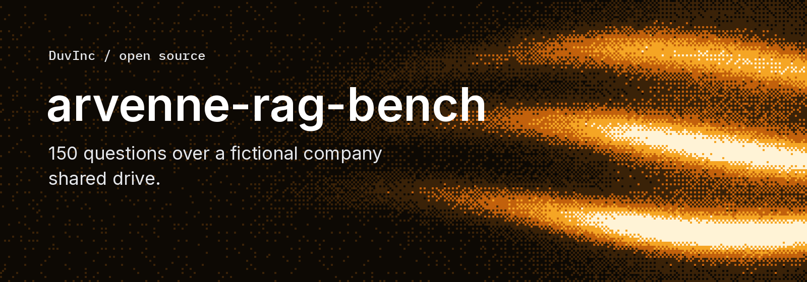

# Arvenne RAG Bench

**Test whether a document assistant can answer from a company's files, including the awkward ones.**

150 questions, 25 fictional business documents, 11 file formats. Scans, handwriting, charts, spreadsheets, conflicting policies and questions the files cannot answer. Download the corpus without running a model.



```sh
git clone git@github.com:DuvInc/arvenne-rag-bench.git
cd arvenne-rag-bench
npm test
python3 -m venv .venv
.venv/bin/pip install -r requirements.txt
.venv/bin/python scripts/verify.py
```

The verifier checks 53 reference and document invariants. It recomputes table-derived answers from the released CSV and XLSX files, independently of the document generator. `npm test` requires Node 22+ and Python 3; it checks structure, hashes and strict scoring without third-party Python packages or network access.

## Start with the corpus, not the answer key

```text
corpus/                         Files to ingest
dataset/questions_blind.jsonl   Questions to send to your system
dataset/questions.jsonl         References, tolerances, rubrics and evidence paths
dataset/JUDGING.md              Grading instructions
scripts/verify.py               Independent checks of the released files
scripts/score.py                Local strict scoring from supplied verdicts
build/                         Seeded generators and licensed fonts
docs/DESIGN.md                  Spoilers for maintainers, not model context
```

Arvenne Cycles is a fictional cargo-bike manufacturer in Lyon. The shared drive contains sales and warranty tables, a product catalogue, supplier agreements, HR policies, meeting notes, a whiteboard photo and a handwritten test notebook. The corpus includes English, French and German material. There are no real customer records.

The questions have four difficulty levels: 40 find, 40 read, 40 combine and 30 expert. Of the 150 questions, 58 have numeric references, 33 require OCR or visual reading, 77 need several documents and 65 involve a table. Categories overlap. The [dataset card](dataset/README.md) describes the fields and the [design notes](docs/DESIGN.md) explain the traps.

## Evaluate your own assistant

1. Ingest only `corpus/`, retaining the files' relative paths as source names.
2. Send each question from `questions_blind.jsonl` to the system. Do not ingest references, generators, scoring scripts or design notes.
3. Save one JSON object per answer: `{"id":"ARB-001","answer":"..."}`.
4. Grade against the reference and rubric in `questions.jsonl`. Save `{"id":"ARB-001","verdict":"correct"}` in a verdict file, using `correct`, `partial` or `wrong`.
5. Run `.venv/bin/python scripts/score.py predictions.jsonl --judged judged.jsonl`.

The headline score is **fully correct answers divided by all 150 questions**. Partial answers receive no points. Missing predictions or judgments remain in the denominator. The scoring command reports coverage and fails when grading is incomplete. Numeric checks are available separately as diagnostics; finding an expected number somewhere in a long answer is not sufficient evidence that the whole answer is correct.

Use judges blind to the system identity. Name the judge and its configuration, report whether the system could read images, and disclose the number of attempts allowed. The supplied grading rubric is a starting point, not a substitute for reviewing ambiguous cases.

## Rebuild the documents

The checked-in corpus is ready to use. To regenerate it with the pinned Python environment:

```sh
sh build/build.sh
```

The seed controls the fictional facts and generated tables. Different rendering-library versions or PDF metadata can change file bytes, so use the checked-in corpus and its checksums for a fixed evaluation. Rebuilding does not silently update the release checksums.

## Scope and independence

This benchmark measures business-document reading, calculation and restraint on a small corpus. It does not measure web-scale retrieval, production availability, access control or every kind of RAG workload. Difficulty labels were assigned by design, not statistically calibrated across many systems.

Arvenne was created by **Guillaume Duvernay, the developer of Lookio**. Its questions and references were frozen before running systems on it. It is not an independent external endorsement of Lookio. The separate [Lookio evaluation](https://github.com/DuvInc/lookio-rag-evaluation) includes it alongside DataBench and HybridQA. This repository contains no Lookio implementation or evaluation results.

## License and contributions

Original code, corpus and annotations: [MIT](LICENSE). Bundled fonts retain their [upstream licenses](build/fonts/README.md). See [CONTRIBUTING.md](CONTRIBUTING.md), [AGENTS.md](AGENTS.md) and [SECURITY.md](SECURITY.md). Maintenance is best-effort.
